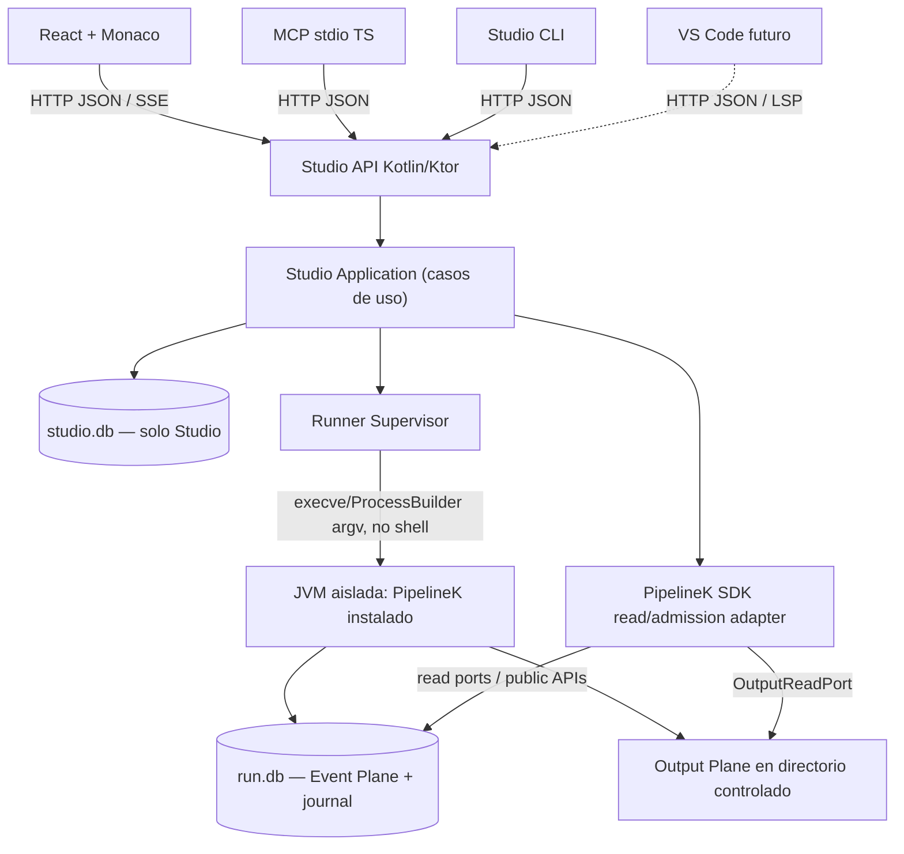
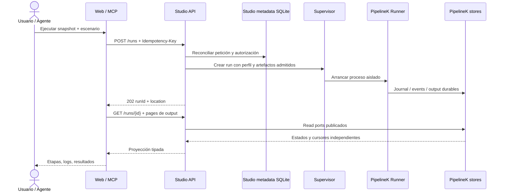

# Arquitectura — Studio como producto hexagonal local-first

## Principio de propiedad

`studio-domain` modela experimentos, snapshots, escenarios, autorización y operaciones. `studio-application` aplica reglas de transición y orquesta puertos. Los adaptadores HTTP/MCP/CLI serializan contratos: ningún adaptador puede decidir outcome, ejecutar handlers ni saltarse autorización. Los adaptadores PipelineK traducen a **interfaces públicas** del SDK/runtime; los scripts y plugins se ejecutan exclusivamente en runner supervisado.

## Diagrama de proceso y autoridad



## 3 planos; no mezclarlos

1. **Control:** crear run, programar, cancelar, detectar muerte de runner, adquirir permisos; Studio es coordinador del experimento, pero **PipelineK sigue siendo coordinador de efectos**.
2. **Event Plane:** eventos de dominio/journal durable con secuencia de eventos; autoridad de PipelineK. No inferir stdout desde eventos.
3. **Output Plane:** bytes confirmados por stream/operación y cursor independiente; autoridad de PipelineK. Nunca construir un cursor desde números de evento.

## Flujo de ejecución



## Fronteras de confianza

- **Browser:** no puede leer SQLite, plugins/JAR ni directorios del host; aplica CSP, sanitización, autenticación local, Origin check y request-size bounds.
- **MCP adapter:** proceso Node separado por stdio, stdout reservado para MCP, secret/token en canal protegido o transporte local autenticado. No contiene reglas de Step ni SQL.
- **Backend:** proceso de larga duración de confianza; jamás carga/evalúa bytecode arbitrario de usuario o providers externos dentro del proceso servidor. Metadata JVM extraída de JAR estáticamente antes de cargar plugins; para conocer contribuciones dinámicas, usar proceso scanner aislado.
- **Runner:** proceso hijo bajo profile de sistema operativo. JVM separada mejora aislamiento de fallo **pero no es sandbox**; falta caracterizar contención real antes de ofrecer ejecución no confiable.
- **SQLite durable:** no permitir dos ejecutores concurrentes escribiendo el mismo run DB. El journaling y la serialización de eventos siguen bajo PipelineK; Studio aplica ownership de run y evita abrir `SqliteEventStore` en modo escritor desde backend.

## Módulos Gradle/Node recomendados, extraer progresivamente

```text
pipelinek-studio/
  backend/
    studio-domain/       // IDs, tipos, invariantes, sin frameworks
    studio-application/  // puertos y use cases
    studio-infra/        // SQLite metadata, supervisión, adapter SDK
    studio-http/         // Ktor, OpenAPI y SSE
  apps/web/              // React + Monaco, thin client
  apps/mcp/              // TS @modelcontextprotocol/server; thin adapter
  packages/api-client/  // cliente generado OpenAPI
  contracts/             // YAML, JSON fixtures, UAT wire
  testkit/               // E2E cliente doble, fixture plugin externo
```

No crear directorios vacíos por anticipación. Para S0 es válida una JVM host API con módulos de domain/application/adapter en un único proyecto Gradle, siempre que las pruebas de dependencia impidan crecimiento acoplado.

## No duplicar PipelineK

- Studio no compila por heurísticas `.pipeline.kts`; invoca host/public compile port o runner real.
- Studio no implementa Steps a partir de JSON; reutiliza contrato y codec del SDK, sin excepción por StepKey.
- Studio no decide el resultado de una run interpretando texto stdout ni exit code aislado; traduce outcomes confirmados del motor.
- Studio no añade columnas a DB upstream ni modifica su esquema.
- Studio no mantiene catálogo hardcoded de Steps. Entradas no verificables = `NOT_AVAILABLE` con causa.
- Studio no transforma `Unknown/Refused/Unobservable` en `Success`.

## Contratos públicos upstream necesarios

- `PipelineKRuntimeFacade`: metadata de versión y capacidades instaladas.
- `PluginInspectionPort`: inspección de manifest/identidad sin cargar clases del JAR.
- `StepCatalogReadPort`: registry snapshot admitido y schemas publicados.
- `PipelineRunnerPort`: preparar, ejecutar/cancelar, obtener handle, reconciliar.
- `RunReadPort` + `OutputReadPort`: estado, etapas, eventos y output paginado.
- `CompilerDiagnosticsPort`: análisis estático genuino o `Unsupported`; nunca usar evaluación de Kotlin bajo la etiqueta analyze.

Los nombres anteriores son **puertos de Studio propuestos**, no APIs declaradas ya en PipelineK. Implementarlos mediante adaptadores al SDK o abrir cambios genéricos upstream cuando no exista un seam pública y estable. Documentar cada gap con test que lo demuestre.

## Referencias normativas

- `SCRIPTING_COMPILER_SPEC.md`, `STEP_PLUGIN_SDK.md`, `STEP_PLUGIN_CERTIFICATION.md`, `CLI_OBSERVABILITY_SPEC.md`, `RECOVERY_DURABILITY.md` upstream; ubicaciones en `UPSTREAM_GROUNDING.md`.
- ADR-001–ADR-012 de este paquete.
