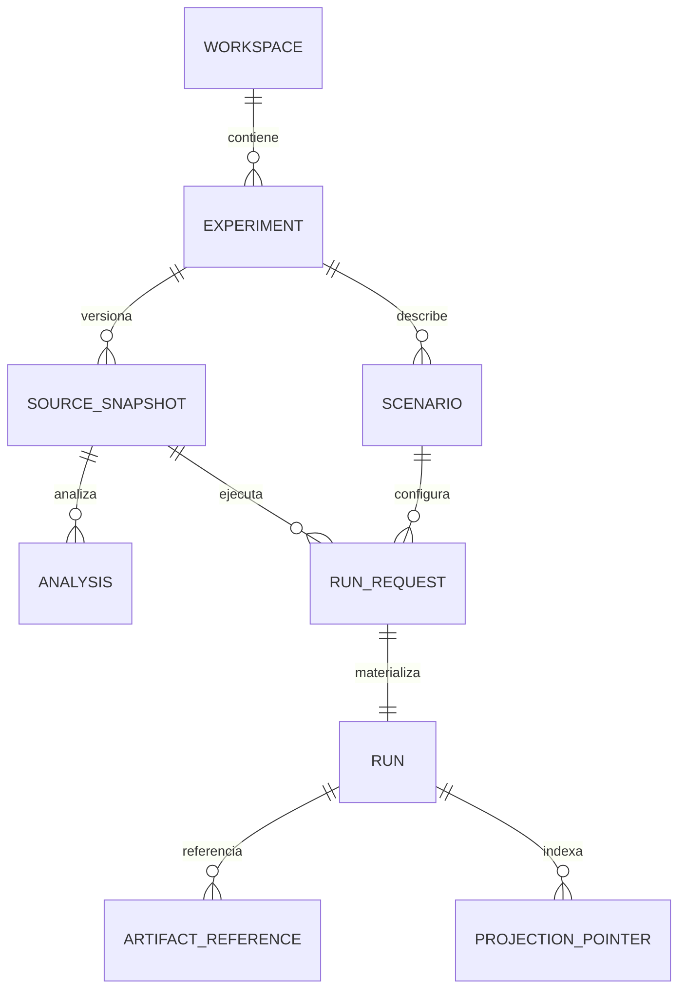

# Modelo de datos, SQLite y durabilidad

## Un único identificador por concepto



### Tipos del dominio de Studio (pseudomodelo)

- `WorkspaceRef(id, pathAuthority, trustProfile)` — el filesystem de usuario no es automáticamente ejecutable ni borrable.
- `ExperimentId` y `Experiment` — contenedor lógico con snapshots y escenarios.
- `SnapshotId`, `SourceSnapshot(bytesSha256, content, dependenciesDigest, creator, createdAt)` — inmutable. Código puede ser fichero `.pipeline.kts` o fragmento con contexto explícito; un cambio produce nuevo snapshot.
- `ScenarioId`, `Scenario(version, inputRefs, expectedOutcomes, environmentProfile, pluginLockDigest)` — inmutable al ejecutar; secrets por handle, nunca valores.
- `OperationId`, `IdempotencyKey`, `RunId` — identidades distintas. `Operation` = petición a Studio, `Run` = ejecución en PipelineK.
- `RunBinding(runId, snapshotId, scenarioId, runtimeVersion, pluginArtifactDigests, eventDatabaseRef, outputControlRootRef, ownerLease, state)`.
- `AnalysisRef(snapshotId, kind, toolVersion, configurationDigest, diagnosticsRef)`; análisis nunca confiere permiso de run.
- `ArtifactReference(digest, kind, uri, size, trustLevel)` — no aceptar rutas arbitrarias del cliente; generar URLs autenticadas y acotadas.

## Estado durable y transiciones

`CREATED → ADMITTED → QUEUED → STARTING → RUNNING → {SUCCEEDED,FAILED,CANCELLED,REFUSED}`; también `RECOVERY_REQUIRED`, `LOST`, `UNKNOWN` cuando la autoridad aún no certifica terminal. El supervisor no inventa `FAILED` al perder el proceso si PipelineK puede reconciliar. No confundir `CANCEL_REQUESTED` con cancelación consumada. Correlacionar cualquier transición de Studio con autoridad/eventos de runtime y registrar `observedAt`.

## Dos bases de datos SQLite

**Studio metadata (`studio.db`)**: experiments/snapshots/scenarios/operations/idempotency map/run_bindings/analysis refs. SQL de ejemplo esquemático:

```sql
CREATE TABLE experiments (
  experiment_id TEXT PRIMARY KEY,
  workspace_id TEXT NOT NULL,
  created_at TEXT NOT NULL
);
CREATE TABLE snapshots (
  snapshot_id TEXT PRIMARY KEY,
  experiment_id TEXT NOT NULL REFERENCES experiments(experiment_id),
  sha256 TEXT NOT NULL,
  source_utf8 BLOB NOT NULL,
  created_at TEXT NOT NULL
);
CREATE TABLE run_bindings (
  studio_run_id TEXT PRIMARY KEY,
  experiment_id TEXT NOT NULL REFERENCES experiments(experiment_id),
  snapshot_id TEXT NOT NULL REFERENCES snapshots(snapshot_id),
  scenario_id TEXT NOT NULL,
  upstream_run_id TEXT,
  run_db_ref TEXT,
  control_root_ref TEXT,
  runtime_digest TEXT NOT NULL,
  plugin_set_digest TEXT NOT NULL,
  status TEXT NOT NULL
);
CREATE TABLE idempotency (
  scope_id TEXT NOT NULL,
  operation_name TEXT NOT NULL,
  key TEXT NOT NULL,
  request_digest TEXT NOT NULL,
  response_ref TEXT,
  PRIMARY KEY(scope_id, operation_name, key)
);
```

**PipelineK durable (`run.db`)**: `SqliteEventStore`, `OperationJournalSchema`, `SqliteOperationJournalImpl` gestionan eventos y operaciones. Studio no realiza migraciones ni DML directo en sus tablas. El `--db` de PipelineK activa el modo persistente; sin él el CLI puede usar store volátil, inaceptable para runs de Studio que deben poder inspeccionarse tras reinicio. La ubicación debe estar bajo `controlRoot` administrado; no confiar en parámetros de ruta externos.

## ¿Un run.db por run o por proyecto?

**Decisión inicial:** un control-root y SQLite durable **por ejecución** para evitar contaminación de leases, colisiones de secuencia y concurrencia entre procesos; promover bases compartidas solo después de probar aislamiento/ownership y throughput. El backend usa metadatos para localizar runs. En S0 caracterizar coste de SQLite per-run y recuperar un proceso supervisor caído.

## Output Plane: NO es tabla de eventos

Event Plane avanza por secuencia asignada por event store. Output Plane avanza por cursor/byte confirmado (`OutputReadPort`, `OutputCursor`). Las respuestas de Studio contienen `eventCursor` y `outputCursor` separados, nunca un único global cursor. Consultar por `runId,opId`, sin inventar stream ID. El output es opaco y bounded; preservar bytes/UTF8 segmentado correctamente. Un `UnknownStream` o `RecoveryNotCompleted` es `Refused`, no una página vacía.

## Concurrencia, reconstrucción y crash

- WAL en SQLite: muchos lectores/un escritor; nunca múltiples `SqliteEventStore` escritores simultáneos al mismo DB sin contrato upstream que lo habilite. El código upstream tiene índice UNIQUE(run_id,sequence) y debe fallar cerrado frente a secuencias duplicadas.
- Backend crash: en startup enumerar operaciones no terminales, resolver leases, examinar estado durable y mostrar `RECOVERY_REQUIRED` o outcome confirmado. No iniciar automáticamente una operación con efectos al reabrir Studio.
- MCP desconectado: la operación sobrevive y se recupera por handle; duplicado del mismo `Idempotency-Key` devuelve la misma operación o rechazo por digest diferente (`409 IDEMPOTENCY_CONFLICT`).
- `DELETE` de una run: aplicar política explícita de retención de snapshots, DB y output; eliminación segura controlada y no en caliente. Nunca eliminar si hay leases vivos/no terminales.
- Protección de secretos: referenciar handles, redactar resultado antes del read-side, no exportar snapshots con secretos sin autorización.
- Migraciones: prefijo `studio_schema_version`, scripts idempotentes con backup/restore test; nunca transformar DB de PipelineK.

## Validaciones

UAT-011, UAT-012, UAT-014, AAT-DUR-001..006, AAT-OBS-001..005. Evaluar coherencia de `events.sequence` tras dos procesos lectores y un único escritor, WAL busy, truncado, restart/kill -9, reinstalación y renombre de directorio de usuario. Probar idempotencia dentro de transacción antes de crear proceso hijo.
