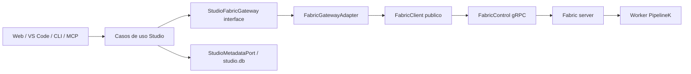

# Especificación normativa propuesta — Studio consumidor de Fabric

**Referencias existentes:** `../01-architecture/ARCHITECTURE.md`, `INTEROPERABILITY_AND_VERSIONING.md`, `RUNNER_COMPILER_AND_SECURITY.md`, `HTTP_AND_STREAMING_API.md`, `MCP_AND_AGENT_PROTOCOL.md`, `STEP_PLUGIN_LAB.md`, `../03-adrs/ADR-002-single-runtime-runner.md`, `../03-adrs/ADR-003-sqlite-output-authorities.md`, `../03-adrs/ADR-005-snapshots-idempotency.md`, `../03-adrs/ADR-013-sse-tree-events.md`.

## 1. Componentes y dirección de dependencias



- `studio-domain`: experimento, snapshot, escenario, comparación, intención/resultado local, identidades tipadas. **No** importar `io.grpc`, `FabricClient`, Protobuf, `Path`, `ProcessBuilder` ni `SqliteEventStore`.
- `studio-application`: puertos de ejecución/consulta; transformaciones puras; persistencia propia de Studio vía puerto; sin dependencias al framework.
- `studio-infra-fabric` (**módulo propuesto**, nombre a ratificar tras inspeccionar Gradle): único adapter gRPC que utiliza los JAR publicados `FabricClient` y `contracts`.
- `studio-http`, `studio-cli`, `studio-mcp`, SPA/VS Code: reciben servicios de aplicación; no nombran Fabric gRPC internamente ni hacen polling sobre `run.db`.
- **No fallback**: Fabric no disponible → `ExecutionUnavailable`, sin lanzar PipelineK desde Studio.

## 2. Ontología y núcleo puro (orientación Haskell)

El dominio no contiene hechos tecnológicos de JVM. Tipos en un único lugar, sin sinónimos descoordinados `RunId`/`UpstreamRunId`/`UUID`.

```kotlin
@JvmInline value class StudioRunId(val value: String)
@JvmInline value class StartRunId(val value: String)
@JvmInline value class FabricRunId(val value: String)
@JvmInline value class ProducerRunId(val value: String)
@JvmInline value class Sha256(val hex: String)

data class RunIntent(
    val studioRunId: StudioRunId,
    val commandId: StartRunId,
    val snapshot: SnapshotId,
    val scenario: ScenarioId,
    val expectedSha256: Sha256,
    val pipelineKey: PipelineKey,
    val parameters: List<ScenarioParameter>,
)
sealed interface StudioExecutionState {
    data object Requested : StudioExecutionState
    data object ResultUnknown : StudioExecutionState // transporte; no simula FAILED
    data class Admitted(val fabricRunId: FabricRunId) : StudioExecutionState
    data class Observed(val fabricRunId: FabricRunId, val state: FabricState) : StudioExecutionState
    data class Rejected(val reason: AdmissionRejection) : StudioExecutionState
}
sealed interface FabricState {
    data object Queued : FabricState
    data object Starting : FabricState
    data object Running : FabricState
    data class Waiting(val interactionId: String) : FabricState
    data class Lost(val waitingOn: String?) : FabricState
    data class Terminal(val outcome: Outcome) : FabricState
}
sealed interface Outcome {
    data object Success : Outcome
    data object Unstable : Outcome
    data class Failure(val typedFailure: FailureInfo) : Outcome
    data class Interrupted(val reason: InterruptionInfo) : Outcome
}
```

*Estas definiciones son un modelo ilustrativo de ADTs de Studio, no firmas de Fabric listas para compilar; evitar duplicar los tipos públicos de Fabric en el módulo adaptador. El adaptador hace la conversión exhaustiva `when`, sin `else`, y los tests demuestran que cada brazo conserva semántica.*

Separar **puro** `prepareIntent`, `interpretAdmission`, `advanceObservation`, `correlateRunIds`, `compareOutcomes`, `mapFailure` de **efectos** `readSnapshot`, `putSnapshot`, `start`, `observe`, `readConsole`, `persist`. `Clock`, `UUID`, `Hashing`, `Transport` son capacidades explícitas inyectadas en el borde. `Either`/`Result` sin excepciones para rechazos esperados; excepciones solo fallos imposibles/no controlados que se traducen en el adapter. No introducir Arrow por defecto: sealed ADTs Kotlin suficientes.

## 3. Persistencia y transiciones

- `studio.db`: copia immutable bytes+digest y metadatos de experimentos, referencias del comando y correlación. Fabric: estado de worker, run y hechos; PipelineK: logs y eventos propios leídos exclusivamente por Fabric.
- La petición completa, el `StartRunId` y su digest de identidad se guardan ANTES de llamar `StartRun` para que el reintento tras caída preserve exactamente los mismos bytes de solicitud.
- **Implementado (persistencia Studio, P0-03):** tabla aditiva `fabric_start_intents` (migración V7) en `studio.db`, clave `studio_run_id` con FK a `run_bindings`, `command_id` único y `request_fingerprint` NOT NULL. El puerto puro `FabricStartIntentStore.reserve(studioRunId, requestFingerprint)` devuelve `Reserved(commandId)` | `Conflict` | `MissingBinding` | `Failure`; la identidad se acuña una sola vez y se relee de la misma conexión, por lo que reintento, tienda recreada y reinicio devuelven el mismo `commandId`. Sin fila en `run_bindings` no hay identidad ni despacho. `lookup` es solo de diagnóstico. La huella canónica es `sha256:<64 hex>`; toda otra forma se rechaza.
- **Implementado (submit reserva antes de enviar, P0-03/S4):** `FabricRunnerAdapter.submit` resuelve primero el `packageDigest` del snapshot, calcula la huella canónica del contenido y llama `reserve`; solo el `Reserved.commandId` llega al cable, mientras `Conflict`, `MissingBinding`, `Failure` y la ausencia de journal se traducen a `Refused` sin llamar a `RunControl.start`. El parámetro de constructor `startIntentStore` es aditivo y su valor por defecto es `null`, que **falla cerrado**: no existe journal in-memory ni identidad aleatoria por envío (el journal de test es solo un doble). La huella cubre `studioRunId`, `snapshotId`, `scenarioId`, `profile`, `packageDigest`, `pipelineKey`, `displayName`, `parameters` y `correlation` con campos autocontenidos `nombre=n:valor` (sin colisiones de delimitador, sin mapas/sets sin orden, sin reloj), y excluye el `commandId` porque es la identidad reservada. Un fallo de transporte conserva la identidad persistida y **no** reintenta automáticamente: el dispatch idempotente del productor Fabric sigue siendo P0-05 (bloqueado).
- **Pendiente (P0-03, límites):** no hay productor real de snapshots en Fabric, ni cliente gRPC cableado, ni boot de producción que construya este adaptador (T4/T5 bloqueados). Lo anterior prueba el camino de Studio con `RunControl` falso y SQLite real, no una ejecución remota.
- **Implementado (integridad de admisión, P0-04):** `RunBindingsH2Store.recordAdmission` rechaza en el propio `UPDATE` (guarda en `WHERE`, no lectura previa) una admisión contradictoria a un `fabric_run_id` o `package_digest` ya establecidos: cero filas actualizadas, valores persistidos intactos. La cancelación sigue resolviéndose sólo por el `fabric_run_id` persistido.
- `StudioRunId` local NO es `FabricRunId`. Mapear de uno a otro en fila de binding, nunca hacer `take(8)` ni inferir mediante cadenas.
- El resultado de `StartRun` pasa `Requested → Admitted(id)` o `Requested → Rejected(r)`; fallo gRPC pasa a `ResultUnknown`. Reconciliar `ResultUnknown` reenviando **misma** petición y `StartRunId` solo cuando Fabric haya corregido el dispatch idempotente.
- Operaciones sin cambio de estado validado no producen eventos `RunFinished` locales. `cancelAccepted` es intención, resultado terminal procede de Fabric.
- Los cambios de formato `runDbRef/controlRootRef` requieren migración aditiva de BD. Lectura de legacy solo si existe información histórica valiosa; nunca continuar escribiéndola.

## 4. Preparación y ejecución del snapshot

- `seal`: SHA-256 sobre UTF-8 exacto; no recompilar ni normalizar saltos de línea en transporte.
- `prepare`: API Fabric de contenido inmutable; almacenar `{digest,key}` y metadata recibida, nunca la ruta física remota.
- `start`: solicitud Fabric existente `{commandId,pipelineKey,displayName,parameters,correlation}` con valor de `commandId` estable y digest del contenido en `pipelineKey`/registro de procedencia. **Implementado (P0-03/S4):** el submit reserva antes del envío con `FabricStartIntentStore.reserve(studioRunId, fingerprint)` y usa sólo el `commandId` del brazo `Reserved`; cualquier otro brazo impide llamar a `StartRun`. La misma petición (mismo `runId` y mismo contenido) reutiliza la identidad persistida a través de timeout, adaptador recreado y reinicio; un `RunId` distinto obtiene un `commandId` distinto. El `commandId` no es el `fabricRunId` asignado por el servidor ni se persiste un id en blanco desde un `AlreadyRunning`.
- `replay`: mismo comando y bytes → mismo run; mismo `StartRunId` con parámetros/digest diferentes → `Conflict`; mismo snapshot en múltiples runs → ejecuciones distintas si distintos commandId.
- Prohibido apuntar directamente a `scriptsRoot` desde Studio o usar una carpeta compartida como canal productivo.

## 5. Observación y representación

- `GetRun` sirve para resumen, pero no se usa como `RunProjection` completo si el RPC no lo proporciona.
- `ObserveRun` obtiene `FactReadResult` y cursor con scope Fabric; guardar secuencia/cursor por `(FabricRunId, consumer)` y no adivinarla. `UnknownRun` ≠ stream vacío; `IncompleteObservation` no cierra run.
- `ReadConsole` se pide con `(FabricRunId, ConsoleRef, byteOffset, maxBytes)`; respetar UTF-8, el número de bytes real y los rechazos `ForeignConsole`, `UnknownConsole`, `NegativeCursor`.
- Los mensajes SSE/VS Code son notificaciones **no autoritativas**; su `Last-Event-ID` necesita historial/replay real o un mecanismo explícito de recuperación `GetRunProjection/ObserveRun`. No mentir con `resume` de bus in-memory sin replay.
- Para un árbol, preferir `GetRunProjection` server-side y deltas posteriores; no fold paralelo a Fabric salvo aprobación de ABI.
- Cuando Fabric no produzca eventos hasta terminal, mostrar "ejecutándose; observación en directo no disponible" y abrir upstream task; prohibido simular actualización live por polling del resumen sin significado.

## 6. Capacidades y plugins

- Studio solo presenta capacidades de la versión Fabric/PK realmente instalada en worker: `runtimeVersion`, `runtimeDigest`, plugin manifest/lock, steps admitidos, `observe-live`, `diagnostics`, `interaction-resolve`.
- Extensiones ajenas se examinan por el catálogo efectivo; no inferir disponibilidad escaneando JAR de Studio. Un feature no ofertado retorna `UNSUPPORTED` tipado y UI lo comunica.
- Análisis/compile-only potencialmente ejecutan código; conservar las precauciones existentes de `RUNNER_COMPILER_AND_SECURITY.md`. No enviar fuente no confiable a un worker sin política de aislamiento declarada.

## 7. Seguridad

- Backend Studio usa `RemoteFabric.overTls(endpoint, token, deadline, TrustAnchor.pemFile(ca))` por defecto en despliegues remotos. Solo loopback explícito permite plaintext. No usar `InsecureTrustManagerFactory` ni credenciales en frontend/VS Code/MCP.
- Fabric tiene `NorthboundOperation` ACL; futura operación de snapshots debe requerir permiso propio y control por tenant/principal, límite tamaño, cuota y rate limit. Digest ≠ autorización.
- El bloqueo de scripts/paths en catálogo impide traversal, symlinks fuera de raíz y cambios entre verificación/uso; auditoría con actor, digest y run id.

## 8. DoD funcional mínimo

Desde una instalación limpia con tres productos publicados: sellar un snapshot, preparar bytes exactos, ejecutar en Fabric por TLS con credencial, observar los hechos/rechazos reales, leer consola por offsets y cancelar o terminar; matar/reabrir Studio y reanudar sin nueva ejecución. Todo con `FabricRunId` real.
