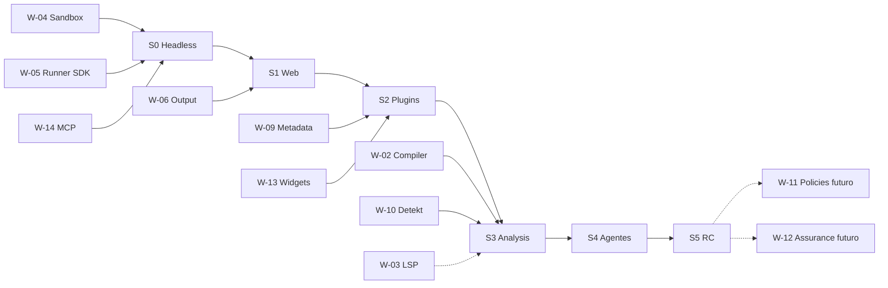

# Wayfinder — mapa de decisiones y frontera activa

**Destino:** producir una Interactive Console web local para PipelineK V2, con ejecución real, SDK de Steps, diagnósticos, SQLite durable y MCP agent-first; sin crear segundo motor ni implementar vistas específicas para Policies/Assurance durante S0–S5.

## Decisiones tomadas

| ID | Resolución | Ficha |
|---|---|---|
| D-01 | React+Monaco web; Kotlin headless independiente | `../03-adrs/ADR-001-web-monaco-headless.md` |
| D-02 | Runtime externo supervisado; Kotlin Script no entra en servidor | `../03-adrs/ADR-002-single-runtime-runner.md` |
| D-03 | Dos SQLite y dos planos de observación distintos | `../03-adrs/ADR-003-sqlite-output-authorities.md` |
| D-04 | HTTP canónico; MCP v2/stdio y CLI adapters thin | `../03-adrs/ADR-004-http-mcp-adapters.md` |
| D-05 | Identidad inmutable por run y requests idempotentes | `../03-adrs/ADR-005-snapshots-idempotency.md` |
| D-06 | STATIC_ANALYZE separado de eval o no disponible | `../03-adrs/ADR-006-compile-versus-eval.md` |
| D-07 | Trust profiles + sandbox probado o fail closed | `../03-adrs/ADR-007-permissions-sandbox.md` |
| D-08 | Manifest before classloading | `../03-adrs/ADR-008-plugin-admission-first.md` |
| D-09 | Extensiones tipadas genéricas, Policies/Assurance futuros | `../03-adrs/ADR-009-generic-extensions.md` |
| D-10 | Detekt adapter; LSP spike independiente | `../03-adrs/ADR-010-detekt-lsp.md` |
| D-11 | Cada bloque integrado main y GitHub release real | `../03-adrs/ADR-011-release-main-authority.md` |
| D-12 | Futuro VS Code por API, sin acoplar UI React | `../03-adrs/ADR-012-vscode-seam.md` |

## Incertidumbres abiertas (fichas independientes, una pregunta por ficha)

| ID y título | Tipo | Pregunta resoluble | Depende | Desbloquea / criterio de cierre |
|---|---|---|---|---|
| [W-02](wayfinder-tickets/W-02-compiler-purity.md) Compiler purity | Investigación+prototipo | ¿Existe ruta compile-only segura para `.pipeline.kts` y plugins admitidos? | Scripting host real | Probar canario 0 efectos o mantener UNSUPPORTED |
| [W-03](wayfinder-tickets/W-03-kotlin-lsp.md) Monaco Kotlin LSP | Prototipo | ¿Analiza `.pipeline.kts` con classpath plugins exacto y rangos correctos? | [W-02](wayfinder-tickets/W-02-compiler-purity.md) parcialmente | Abrir opción LSP, no gate S0–S2 |
| [W-04](wayfinder-tickets/W-04-sandbox-os.md) Sandbox OS | Investigación+prototipo | ¿Qué restricciones filesystem/red/process funcionan en kernel objetivo? | Linux host | S0 profile truthful; no trusted fallback |
| [W-05](wayfinder-tickets/W-05-runner-sdk.md) SDK runner seam | Investigación | ¿Qué API pública permite invocación/cancelación y read-side sin reimplementar motor? | Upstream S6/main | S0, S1, S2 |
| [W-06](wayfinder-tickets/W-06-output-seal.md) Output channel & seal | Prototipo | ¿Output Plane conserva/certifica bytes/EOF y canales de la run instalada? | OBS/main release | S1 parity live/recovery |
| [W-09](wayfinder-tickets/W-09-metadata-catalog.md) Metadata catálogo | Investigación | ¿Qué schema y metadata pública expone cada tipo de Step? | [W-05](wayfinder-tickets/W-05-runner-sdk.md) | S2 forms/fallback, S3 LSP |
| [W-10](wayfinder-tickets/W-10-detekt-scripts.md) Detekt `.pipeline.kts` | Prototipo | ¿Qué reglas y type resolution funcionan con scripts reales sin efectos? | W-02, classpath | S3 |
| [W-11](wayfinder-tickets/W-11-policies-future.md) Policy Lab future | Investigación futura | ¿Qué ResultDescriptor consume un plugin publicado de Policies? | S5 y release Policy | EVO-A, fuera de S0–S5 |
| [W-12](wayfinder-tickets/W-12-assurance-future.md) Assurance Lab future | Investigación futura | ¿Qué proyección de Evidence/Counterexample puede exponer un plugin publicado? | S5 y release Assurance | EVO-B, fuera de S0–S5 |
| [W-13](wayfinder-tickets/W-13-result-widgets.md) Studio result widgets | Investigación | ¿Qué vistas genéricas cubren resultados tipados sin JS del plugin? | [W-09](wayfinder-tickets/W-09-metadata-catalog.md) | S2 result renderer |
| [W-14](wayfinder-tickets/W-14-mcp-v2.md) MCP v2 multi-client | Prototipo | ¿La configuración stdio v2 real funciona con agente objetivo y no duplica runs? | SDK v2 versión fijada | S0/S4 |

## Dependencias / frontera

**Frontera inmediata:** W-04, W-05, W-14 pueden investigarse en paralelo, cada una con evidencia distinta. No fingir que existe un gestor de tickets externo o que se han asignado dueños. W-02 y W-10 deben caracterizarse antes de prometer función de análisis estático; su bloqueo no impide la run aislada de S0/S1.

## Aún por especificar

- Compatibilidad Windows/macOS y su aislamiento (fuera MVP Linux, salvo decisión comercial futura).
- Límites precisos de rendimiento basados en medición y presupuesto de soporte.
- Retención por defecto y política de backups de snapshots grandes.
- Instrumentación de debugging semántico de Steps durables sin alterar outcomes.

## Fuera de alcance

- UI de Policies y Assurance hasta sus releases públicas y ADR de visualización.
- SaaS multiusuario; motores alternativos a PipelineK; Groovy; JVM debugger instruction-level.
- MCP como sustituto de toda la API de la aplicación; Agent con privilegios de administrador por defecto.

## Próximo movimiento

El agente ejecuta **S0** sin resolver ficticiamente las fichas: primero mide W-04, W-05 y W-14, luego implementa la vertical según resultados. Se permite cerrar una ficha de investigación solo con referencia a prueba/repositorio/receipt real; prototipos requieren evaluación del resultado real y aceptación humana cuando impliquen elección de producto abierta.
